# Entity relationships

> Generated by `database/tests/generate_docs.mjs` from the foreign keys of the live schema. Every organization-owned relationship is a composite `(organization_id, parent_id)` foreign key; the diagrams show the logical parent → child relationship once per column. Tables shown in a domain diagram without attributes belong to another domain. `organizations` and `profiles` are referenced by almost every table and are omitted from the edges for readability (every organization-owned table has `organization_id`; audit columns such as `created_by` point at `profiles`).

Legend: `A ||--o{ B` = one A has many B. Optional parents (nullable keys) are drawn as `|o--o{`.

## Identity, organizations and security

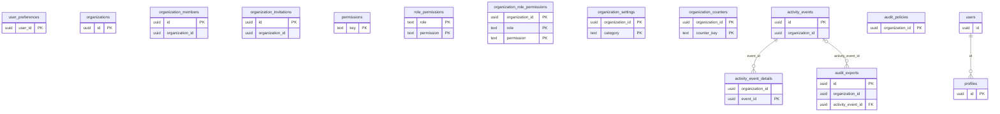

## Portfolio: owners, properties, units, vendors

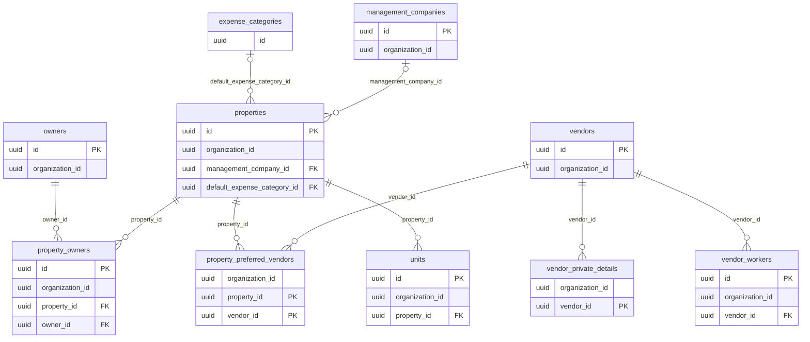

## Tenancy: tenants, applications, leases

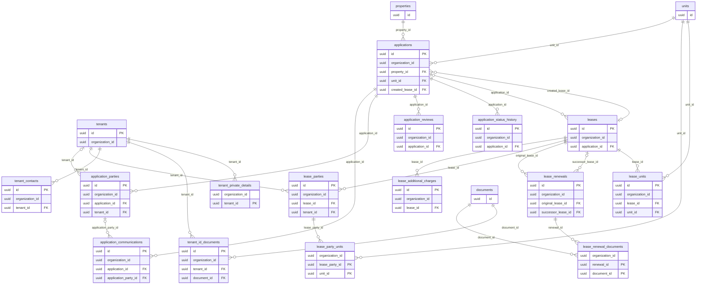

## Documents and e-signatures

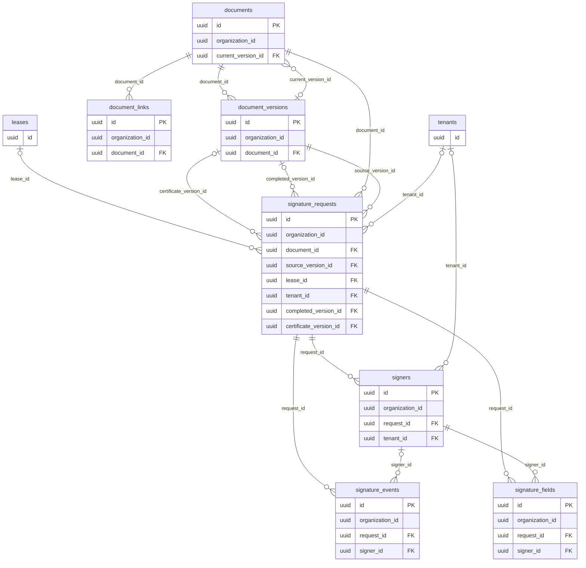

## Accounting: chart, journal, banks

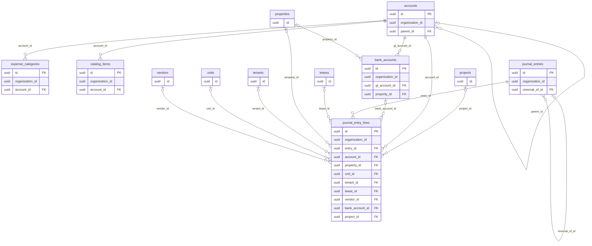

## Receivables: invoices, payments, credits

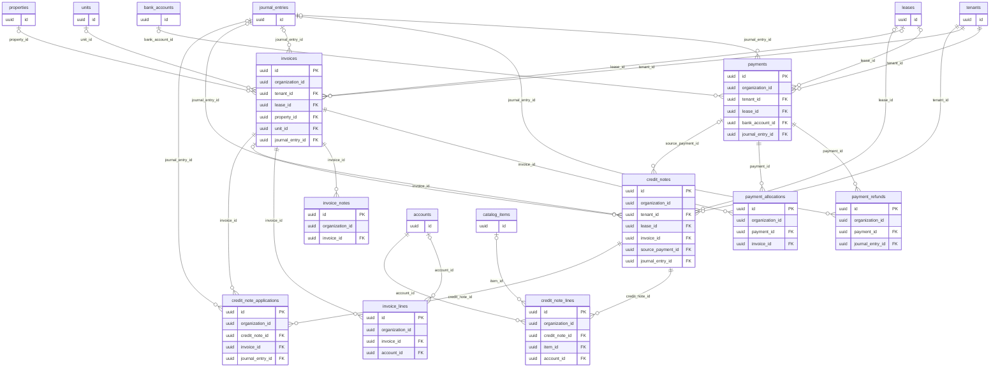

## Payables: expenses and bills

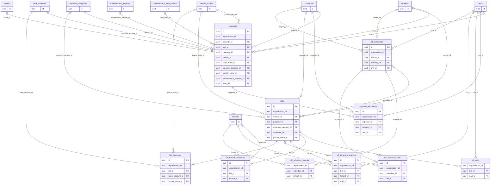

## Bank reconciliation

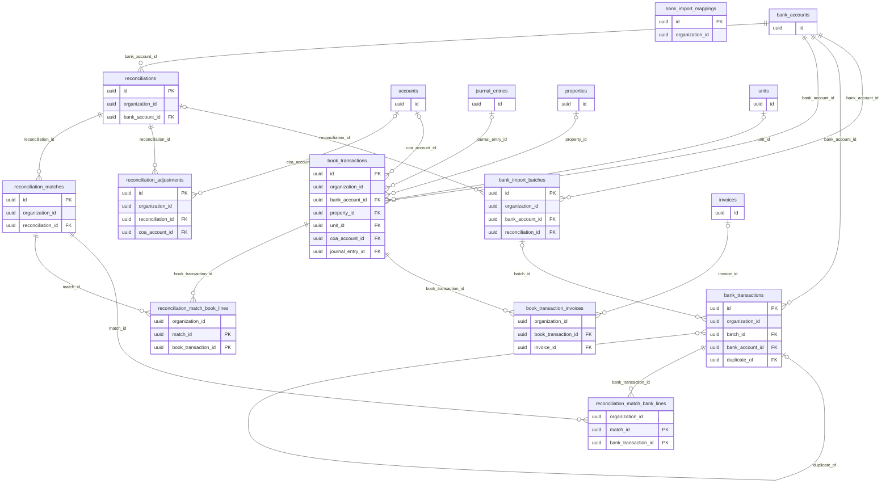

## Security deposits

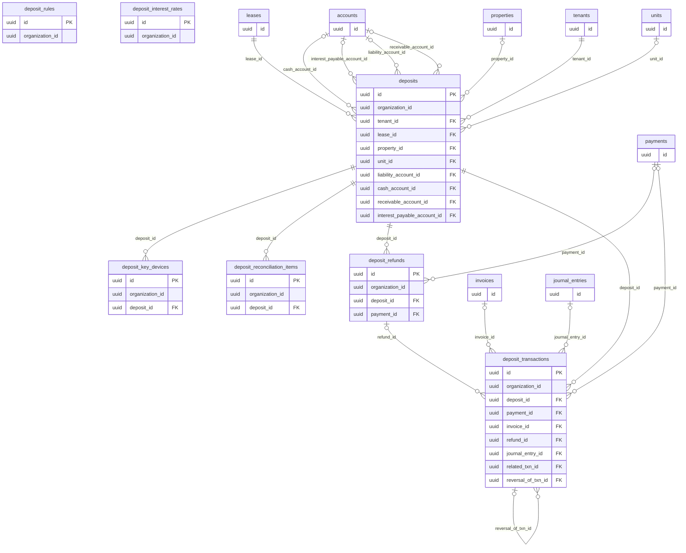

## Maintenance

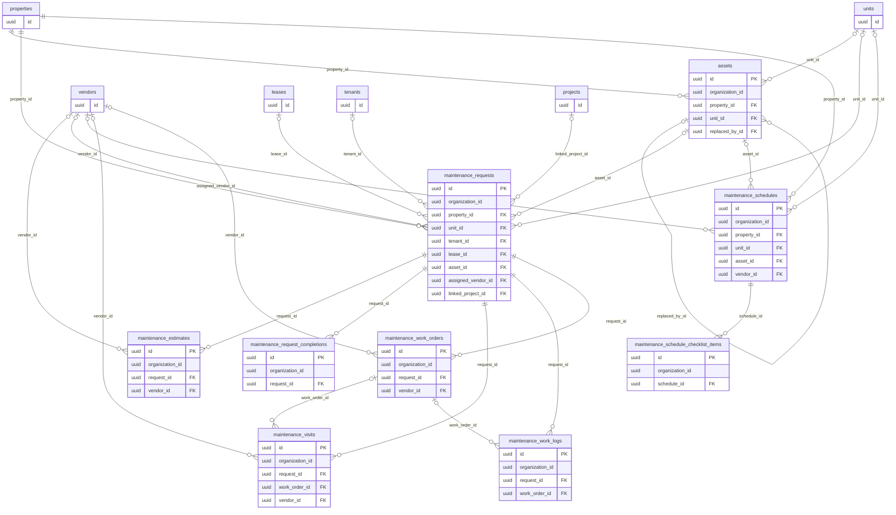

## Projects

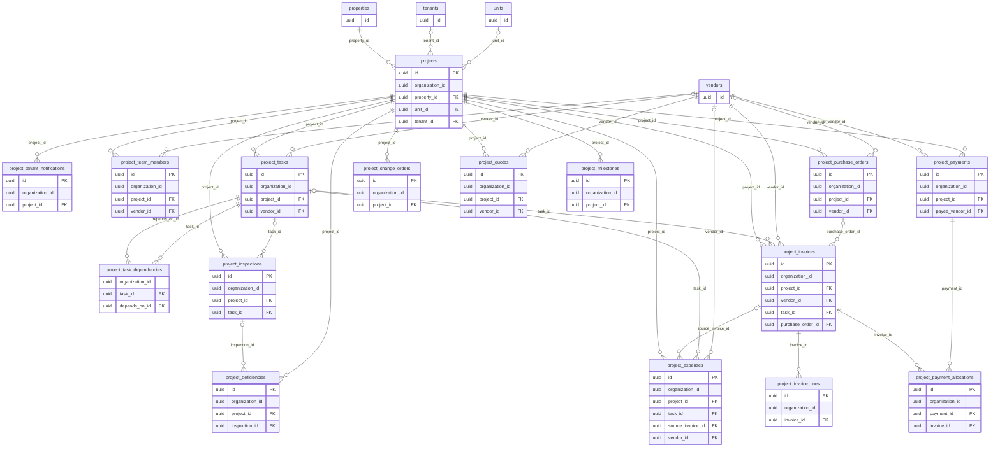

## Communication, automation and scheduling

```mermaid
erDiagram
  message_templates {
    uuid id PK
    uuid organization_id
  }
  message_template_properties {
    uuid organization_id
    uuid template_id PK
    uuid property_id PK
  }
  message_template_attachments {
    uuid organization_id
    uuid template_id PK
    uuid document_id PK
  }
  message_template_versions {
    uuid id PK
    uuid organization_id
    uuid template_id FK
  }
  automation_rules {
    uuid id PK
    uuid organization_id
    uuid template_id FK
  }
  automation_rule_conditions {
    uuid id PK
    uuid organization_id
    uuid rule_id FK
  }
  automation_rule_properties {
    uuid organization_id
    uuid rule_id PK
    uuid property_id PK
  }
  communication_logs {
    uuid id PK
    uuid organization_id
    uuid template_id FK
    uuid automation_rule_id FK
    uuid property_id FK
    uuid unit_id FK
    uuid tenant_id FK
  }
  communication_log_attempts {
    uuid id PK
    uuid organization_id
    uuid log_id FK
  }
  tenant_communication_preferences {
    uuid organization_id
    uuid tenant_id PK
  }
  property_notification_settings {
    uuid organization_id
    uuid property_id PK
  }
  conversations {
    uuid id PK
    uuid organization_id
  }
  conversation_participants {
    uuid id PK
    uuid organization_id
    uuid conversation_id FK
    uuid tenant_id FK
    uuid vendor_id FK
    uuid owner_id FK
  }
  messages {
    uuid id PK
    uuid organization_id
    uuid conversation_id FK
    uuid sender_tenant_id FK
    uuid sender_vendor_id FK
    uuid sender_owner_id FK
    uuid reply_to_message_id FK
  }
  message_attachments {
    uuid organization_id
    uuid message_id PK
    uuid document_id PK
  }
  conversation_stars {
    uuid organization_id
    uuid conversation_id PK
    uuid user_id PK
  }
  conversation_events {
    uuid id PK
    uuid organization_id
    uuid conversation_id FK
  }
  announcements {
    uuid id PK
    uuid organization_id
  }
  announcement_targets {
    uuid organization_id
    uuid announcement_id FK
    uuid property_id FK
    uuid unit_id FK
  }
  announcement_acknowledgements {
    uuid organization_id
    uuid announcement_id FK
    uuid tenant_id FK
  }
  notifications {
    uuid id PK
    uuid organization_id
    uuid conversation_id FK
    uuid property_id FK
  }
  notification_preferences {
    uuid organization_id PK
    uuid user_id PK
    text category PK
  }
  domain_events {
    uuid id PK
    uuid organization_id
  }
  workflow_executions {
    uuid id PK
    uuid organization_id
    uuid rule_id FK
    uuid event_id FK
    uuid communication_log_id FK
  }
  scheduled_tasks {
    uuid id PK
    uuid organization_id
  }
  scheduled_task_runs {
    uuid id PK
    uuid organization_id
    uuid task_id FK
  }
  tenants {
    uuid id
  }
  properties {
    uuid id
  }
  units {
    uuid id
  }
  owners {
    uuid id
  }
  vendors {
    uuid id
  }
  documents {
    uuid id
  }
  organization_members {
    uuid id
  }
  announcements ||--o{ announcement_acknowledgements : "announcement_id"
  tenants |o--o{ announcement_acknowledgements : "tenant_id"
  announcements ||--o{ announcement_targets : "announcement_id"
  properties ||--o{ announcement_targets : "property_id"
  units |o--o{ announcement_targets : "unit_id"
  automation_rules ||--o{ automation_rule_conditions : "rule_id"
  properties ||--o{ automation_rule_properties : "property_id"
  automation_rules ||--o{ automation_rule_properties : "rule_id"
  message_templates |o--o{ automation_rules : "template_id"
  communication_logs ||--o{ communication_log_attempts : "log_id"
  automation_rules |o--o{ communication_logs : "automation_rule_id"
  properties |o--o{ communication_logs : "property_id"
  message_templates |o--o{ communication_logs : "template_id"
  tenants |o--o{ communication_logs : "tenant_id"
  units |o--o{ communication_logs : "unit_id"
  conversations ||--o{ conversation_events : "conversation_id"
  conversations ||--o{ conversation_participants : "conversation_id"
  owners |o--o{ conversation_participants : "owner_id"
  tenants |o--o{ conversation_participants : "tenant_id"
  vendors |o--o{ conversation_participants : "vendor_id"
  conversations ||--o{ conversation_stars : "conversation_id"
  documents ||--o{ message_attachments : "document_id"
  messages ||--o{ message_attachments : "message_id"
  documents ||--o{ message_template_attachments : "document_id"
  message_templates ||--o{ message_template_attachments : "template_id"
  properties ||--o{ message_template_properties : "property_id"
  message_templates ||--o{ message_template_properties : "template_id"
  message_templates ||--o{ message_template_versions : "template_id"
  conversations ||--o{ messages : "conversation_id"
  messages |o--o{ messages : "reply_to_message_id"
  owners |o--o{ messages : "sender_owner_id"
  tenants |o--o{ messages : "sender_tenant_id"
  vendors |o--o{ messages : "sender_vendor_id"
  organization_members ||--o{ notification_preferences : "user_id"
  conversations |o--o{ notifications : "conversation_id"
  properties |o--o{ notifications : "property_id"
  properties ||--o{ property_notification_settings : "property_id"
  scheduled_tasks ||--o{ scheduled_task_runs : "task_id"
  tenants ||--o{ tenant_communication_preferences : "tenant_id"
  communication_logs |o--o{ workflow_executions : "communication_log_id"
  domain_events |o--o{ workflow_executions : "event_id"
  automation_rules ||--o{ workflow_executions : "rule_id"
```

## Scheduled tasks (people-facing work assignments)

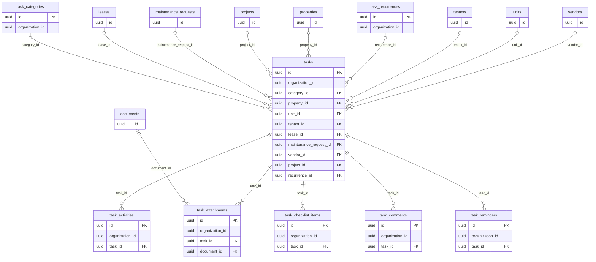

## Cross-cutting references

- 44 tables reference `organizations` (tenant boundary).
- 95 columns reference `profiles` (actors, assignees, uploaders).
- `auth.users` is referenced only by `profiles.id`.
